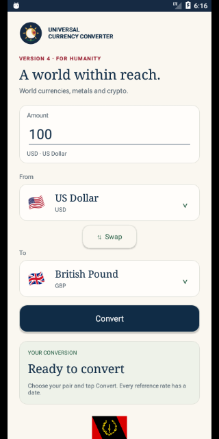
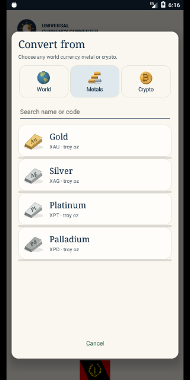
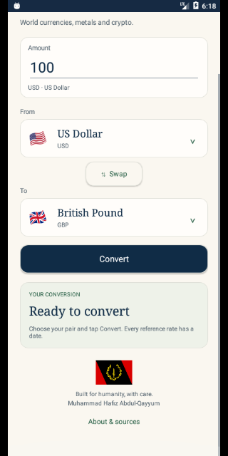

# Universal Currency Converter · Version 4.0

By **Muhammad Hafiz Abdul-Qayyum**, from Clinton Hill, Brooklyn, New York City, USA. Built for humanity, with care.

**[Download Version 4.0](https://github.com/muhammad-abdulqayyum/Currency-Converter/raw/refs/heads/master/android-installer-file/Currency-Converter-4.0.apk)** · Android 6.0+ · debug-signed preview.

## Version 4

Choose **From** and **To** independently. Both pickers offer **World**, **Metals**, and **Crypto** tabs and search by name or code. Tap an asset to select it immediately. **Swap** reverses the pair while keeping the entered number; the source unit changes visibly.

Convert across categories: BRL → PHP, gold → silver, BTC → gold, XRP → BTC, and other available pairs. The catalog contains **156 world currencies** (including USD), **four metals** (gold, silver, platinum, palladium), and **five cryptocurrencies** (BTC, ETH, XRP, LTC, BCH): **165 selectable assets**.

The cream/navy interface uses serif asset names, locally drawn bullion marked Au/Ag/Pt/Pd, coin illustrations and a gentle Americas-centered globe inside the picker. System animation preferences are respected. The scrollable footer keeps the Black American Heritage Flag, author credit and About button together.

Amounts accept up to eight decimal places and a maximum of one trillion source units. Metals use **troy ounces** (31.1034768 grams), not bars or ordinary ounces; crypto uses units of the selected coin. Same-asset conversions return the entered amount without a rate lookup.

## Reference rates

All fetched rates come from [Frankfurter v2](https://frankfurter.dev/). Crypto quotes require Swiss Federal Tax Administration (ESTV) provenance; they are dated reference values, not live trading prices. Quotes exclude dealer premiums, transaction fees and spreads.

The calculation uses a common USD reference:

`output = amount × destination units per USD ÷ source units per USD`

Decimal arithmetic rounds only the final output. USD has a reference value of one. Both legs keep their own source and date. If dates differ, the app explicitly identifies the result as an indicative comparison. Requested pairs, positive bounded rates, valid dates and crypto provenance are validated. Future dates or quotes older than seven UTC days are rejected; values older than three days have an age warning.

The bundled catalog includes national, shared and territorial currencies. It excludes historical ANG/SVC, offshore CNH and accounting units CMD/XDR; CNY and XCG are available. Flags identify currency areas and are not statements about sovereignty. Names and codes remain visible when older Android versions lack a flag glyph. An included asset is not a guarantee that its provider will always publish a usable quote.

## Lightweight and private

No account, ads, analytics SDKs, private API keys or application backend. Only validated rate snapshots are cached locally, reusable for six hours. If refreshing fails, a valid saved quote up to seven days old may be shown with an explicit offline label. Amounts and conversion history are not written to persistent storage; current input and pair survive normal activity recreation.

HTTPS certificate validation, connection/read timeouts, response size limits and duplicate-request prevention remain enabled. No insecure network fallback is used.

## Install and build

Version 4.0 uses version code 40. This rebuilt preview has a **new debug signing certificate**: uninstall a differently signed 3.x preview before installing it. This clears that app's local rate cache. Future production distribution needs a stable private signing/upload key; never commit private keys.

[Version 3.1](https://github.com/muhammad-abdulqayyum/Currency-Converter/raw/refs/heads/master/android-installer-file/Currency-Converter-3.1.apk) · [Version 3.2](https://github.com/muhammad-abdulqayyum/Currency-Converter/raw/refs/heads/master/android-installer-file/Currency-Converter-3.2.apk) · [Version 3 history](docs/version-3-history.md)

Requires JDK 17, Gradle 8.9, Android SDK 35 and build tools 35.0.0:

```sh
gradle -p project testDebugUnitTest lintDebug assembleDebug
python3 scripts/validate_rates.py
```

Minimum Android 6.0/API 23; compile/target SDK 35. Play publishing needs a production build and review of current store requirements. See [release validation](docs/version-4-validation.md).

## Preview







## About

“From your Brother Muhammad Hafiz Abdul-Qayyum in the Wilderness of North America.”

For humanity. If Allah wills.

[Illustration credits](THIRD_PARTY_NOTICES.md). Original project uploaded in 2017. Land, advertising, paid upgrades and live market feeds remain outside this release.
