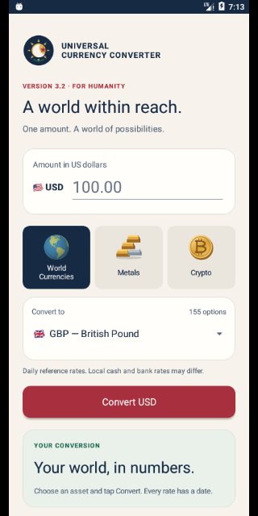
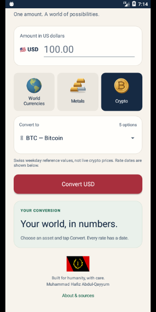

# Universal Currency Converter · Version 3.2

A lightweight Android reference converter by **Muhammad Hafiz Abdul-Qayyum**, Clinton Hill, Brooklyn, New York City, USA. Built for humanity, with care.

Enter a USD amount, choose **World Currencies**, **Metals**, or **Crypto**, select an asset from the dropdown, and tap **Convert USD**.

**[Download the Version 3.2 preview APK](https://github.com/muhammad-abdulqayyum/Currency-Converter/raw/refs/heads/master/android-installer-file/Currency-Converter.apk)** · Android 6.0+ · debug-signed preview. See signing notes below if upgrading from a previous debug build.

## Version 3.2

Everything in 3.1, plus one gentle west-to-east globe revolution over ten seconds, resting on the Americas. Tap World Currencies to replay. The globe pauses in the background, when scrolled out of view, or while another category is selected. Disabling system animations keeps the globe static. No continuous spin, network request or animation library is needed.

[Install 3.1 (static)](https://github.com/muhammad-abdulqayyum/Currency-Converter/raw/refs/heads/master/android-installer-file/Currency-Converter-3.1.apk) · [Install 3.2 (rotating)](https://github.com/muhammad-abdulqayyum/Currency-Converter/raw/refs/heads/master/android-installer-file/Currency-Converter-3.2.apk)

Both builds use the same debug certificate. They replace each other; installing 3.1 after 3.2 requires uninstalling 3.2 first because Android blocks version downgrades. Older 3.0 previews may have a different debug certificate and require uninstalling once.

## Version 3.1

- Static Americas-centered geographic globe, stacked gold/silver bars and a gold Bitcoin coin.
- Bundled Black American Heritage Flag beside the author credit.
- Author location: From Clinton Hill, Brooklyn, New York City, USA.
- Category icons are bundled and rendered locally; no extra API or runtime dependencies.
- See [illustration credits](THIRD_PARTY_NOTICES.md).

## Conversion features

- **155 world currencies:** current national, shared and territorial currencies in the verified bundled catalog, with flag/region symbols, codes and names.
- **Four precious metals:** gold (XAU), silver (XAG), platinum (XPT) and palladium (XPD), in **troy ounces** (31.1034768 grams).
- **Five cryptocurrencies:** Bitcoin, Ethereum, XRP, Litecoin and Bitcoin Cash. Swiss Federal Tax Administration (ESTV) reference values, not live trading prices.
- Cream background, navy text, restrained red and green accents, and an original sun/crescent/star emblem.
- One API, no account, ads, analytics SDKs, private API keys, or application backend.
- **Android 6.0+ (API 23)**; target/compile SDK 35. A Play submission needs a separately prepared production release and current target-SDK review.

## Preview





## Validation

- Both 3.1 and 3.2 installed and launched on Android 6/API 23. Checked all three categories, the heritage flag footer, About credit, and upgrade from 3.1 to 3.2.
- Native 3.2 frames confirm rotation and return to the identical 3.1 Americas view. With system animator duration scale set to zero, successive globe frames are identical. Also checked a narrow screen with larger text.
- 21 JVM unit tests passed; Android lint completed without errors.
- Version 3.2 debug APK measured 93,279 bytes.
- Version 3.1 debug APK measured 90,799 bytes.
- Earlier Version 3.0 validation: installed and launched on an Android 6.0/API 23 emulator. Exercised GBP, gold and BTC conversion screens with validated live-feed snapshots seeded into the local cache, and checked a narrow screen with enlarged text. No runtime crash was observed.
- The separate live-feed check validated all 164 USD pairs. The emulator smoke check does not establish end-to-end network behavior on every supported phone.

## Rates and coverage

All data comes from [Frankfurter v2](https://frankfurter.dev/). The 164 offered USD pairs were checked against its live feed during development. Supported pairs can become unavailable or change later. A catalog entry is not a guarantee of an executable exchange rate.

The catalog includes shared currencies and territorial currencies for broad coverage. Euro-area countries share EUR; XAF, XOF, XCD and XPF serve multiple countries/territories and use neutral regional symbols. It excludes USD as an output (USD is the input), historical ANG/SVC, offshore CNH (CNY is available), and accounting units CMD/XDR. XCG replaces ANG. Flags help identify currency areas and are not statements about sovereignty. Flag glyph appearance depends on Android's emoji font; names and codes remain visible.

A single-pair request uses `/v2/rate/USD/{CODE}?expand=providers`; crypto adds `providers=ESTV`. Responses must have the requested pair, positive bounded numeric rates, valid dates and, for crypto, the ESTV source. The app rejects dates in the future or more than seven UTC calendar days old. Reference dates and sources are displayed. Values older than three days carry an additional age label.

### Lightweight local cache

Only validated rate snapshots are saved locally, one per asset. Snapshots are reused for six hours; calculations with those rates happen on-device. If refreshing fails, a valid saved rate up to seven days old can be used with an explicit saved/connection-unavailable label. Older data is rejected. Amounts and conversion history are not persisted. This cache does not make daily data live.

The app checks HTTPS certificates normally, does not follow redirects, sets connection/read timeouts, limits response size and prevents duplicate in-flight conversions. No insecure certificate bypass or HTTP fallback is used.

## Build and checks

Requires JDK 17, Gradle 8.9 and Android SDK 35/build tools 35.0.0:

```sh
gradle -p project testDebugUnitTest lintDebug assembleDebug
python3 scripts/validate_rates.py
```

The live check is read-only and needs an internet connection. It checks catalog coverage, positive rates, freshness and Swiss crypto provenance. Unit tests cover currency rounding, crypto/metal precision, input boundaries, strict rate dates and cache expiration. GitHub Actions builds and uploads the APK.

Debug build: `project/app/build/outputs/apk/debug/app-debug.apk`. GitHub Actions artifacts use debug signing; signatures from different build environments may differ, requiring uninstalling an earlier debug build. Production publishing requires a stable private signing/upload key; never commit private keys.

## About

“From your Brother Muhammad Hafiz Abdul-Qayyum in the Wilderness of North America.”

For humanity. If Allah wills.

Original project uploaded in 2017. Version 2 modernized the build and exchange-rate integration; Version 3 expands worldwide reference coverage while keeping the interaction simple. Land, advertising, paid upgrades and live market-price feeds are outside Version 3.
