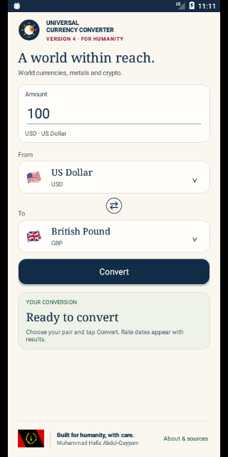
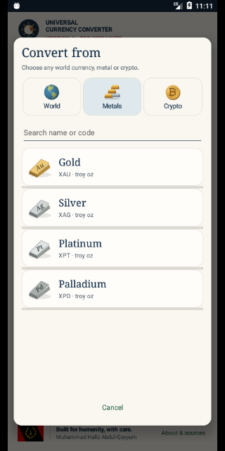

# Universal Currency Converter · Version 4.0.4 preview

By **Muhammad Hafiz Abdul-Qayyum**, from Clinton Hill, Brooklyn, New York City, USA. Built for humanity, with care.

**[Download Version 4.0.4 preview](https://github.com/muhammad-abdulqayyum/Currency-Converter/raw/refs/heads/develop/android-installer-file/Currency-Converter-4.0.4.apk)** · Android 6.0+ · debug-signed preview.

## Version 4.0.4 preview

Dimensional Au/Ag/Pt/Pd bullion, BTC/ETH/XRP/LTC recognition icons and a green BCH coin are bundled identically on Android and iOS. BCH's white B tilts left; BTC tilts right. SAT and DROP keep their parent icons and denomination badges. Android's About screen now correctly reports 4.0.4.

Development and preview APKs live on `develop`; `master` remains the approved release line. Review a preview before merging it. [4.0.4 validation](docs/version-4.0.4-validation.md).

## iPhone and iPad

A native Swift/SwiftUI version is included in [`ios/`](ios/README.md), targeting iOS/iPadOS 15.0 and later, with the same 167 assets and independent pickers. [Validation results](docs/version-4.0.3-validation.md). See the [iOS build and simulator checks](https://github.com/muhammad-abdulqayyum/Currency-Converter/actions/workflows/ios.yml) for validation. TestFlight/App Store distribution requires Apple signing and your developer account; the Android APK does not run on iOS.

## Version 4.0.3

The default screen uses a compact header, a compact circular Swap centered between From and To, and a footer with the heritage flag on the left, the full author credit beside it, and About on the right. Spare vertical space places the footer at the bottom. Narrow screens or larger text move About below the credit and allow natural scrolling.

The visible swap circle is 30 dp with crisp horizontal arrows; its accessible touch target is 48 × 48 dp. The cream/navy colors, serif typography and heritage footer are retained.

## Crypto units in 4.0.3

Satoshi (Bitcoin), code `SAT`, and Drops (XRP), code `DROP`, join the five coins in the Crypto picker. These are denominations, not additional coins: **1 BTC = 100,000,000 satoshis** and **1 XRP = 1,000,000 drops**. BTC ↔ SAT and XRP ↔ DROP use fixed unit ratios without fetching market rates. Other pairs derive the unit rate from the existing BTC or XRP quote and retain its provider, date, cached/offline state and freshness limits. No additional rate API is used. Converted SAT/DROP results round to whole units; a positive result below the smallest displayed unit is labeled `< 1`.

ETH, LTC and XRP now use matching bundled recognition icons on Android and iOS, with small badges distinguishing SAT and DROP from their parent coins. The major version label remains VERSION 4; About reports 4.0.3. Android 6.0+ and iOS/iPadOS 15.0 deployment targets are retained.

## Version 4 features

Choose **From** and **To** independently. Both pickers offer **World**, **Metals**, and **Crypto** tabs and search by name or code. Tap an asset to select it immediately. **Swap** reverses the pair while keeping the entered number; the source unit changes visibly.

Convert across categories: BRL → PHP, gold → silver, BTC → gold, XRP → BTC, and other available pairs. The catalog contains **156 world currencies** (including USD), **four metals** (gold, silver, platinum, palladium), and **seven crypto choices** (BTC, ETH, XRP, LTC, BCH, plus Bitcoin satoshis and XRP drops): **167 selectable assets**.

The cream/navy interface uses serif asset names, locally drawn bullion marked Au/Ag/Pt/Pd, coin illustrations and a gentle Americas-centered globe inside the picker. System animation preferences are respected. The scrollable footer keeps the Black American Heritage Flag, author credit and About button together.

Amounts accept up to eight decimal places and a maximum of one trillion source units. Metals use **troy ounces** (31.1034768 grams), not bars or ordinary ounces; crypto uses units of the selected coin. Same-asset conversions return the entered amount without a rate lookup.

## Reference rates

All fetched rates come from [Frankfurter v2](https://frankfurter.dev/). Crypto quotes require Swiss Federal Tax Administration (ESTV) provenance; they are dated reference values, not live trading prices. Quotes exclude dealer premiums, transaction fees and spreads.

The calculation uses a common USD reference:

`output = amount × destination units per USD ÷ source units per USD`

Decimal arithmetic rounds only the final output. USD has a reference value of one. Both legs keep their own source and date. If dates differ, the app explicitly identifies the result as an indicative comparison. Requested pairs, positive bounded rates, valid dates and crypto provenance are validated. Future dates or quotes older than seven UTC days are rejected; values older than three days have an age warning.

The bundled catalog includes national, shared and territorial currencies. It excludes historical ANG/SVC, offshore CNH and accounting units CMD/XDR; CNY and XCG are available. Flags identify currency areas and are not statements about sovereignty. Names and codes remain visible when older Android versions lack a flag glyph. An included asset is not a guarantee that its provider will always publish a usable quote.

## Lightweight and private

No account, ads, analytics SDKs, private API keys or application backend. Only validated rate snapshots are cached locally, reusable for six hours. If refreshing fails, a valid saved quote up to seven days old may be shown with an explicit offline label. Amounts and conversion history are not written to persistent storage; current input and pair survive normal activity recreation.

HTTPS certificate validation, connection/read timeouts, response size limits and duplicate-request prevention remain enabled. No insecure network fallback is used.

## Install and build

Version 4.0.4 uses version code 44 and the same preview signing certificate as earlier 4.x previews, allowing an in-place update. Older 3.x previews used a different certificate and may require uninstalling once. The preview key is backed up privately for future updates. Production publishing needs a separately prepared release and private signing/upload key; never commit private keys.

[Version 4.0](https://github.com/muhammad-abdulqayyum/Currency-Converter/raw/refs/heads/master/android-installer-file/Currency-Converter-4.0.apk) · [Version 4.0 history](docs/version-4.0-history.md)

[Version 3.1](https://github.com/muhammad-abdulqayyum/Currency-Converter/raw/refs/heads/master/android-installer-file/Currency-Converter-3.1.apk) · [Version 3.2](https://github.com/muhammad-abdulqayyum/Currency-Converter/raw/refs/heads/master/android-installer-file/Currency-Converter-3.2.apk) · [Version 3 history](docs/version-3-history.md)

Requires JDK 17, Gradle 8.9, Android SDK 35 and build tools 35.0.0:

```sh
gradle -p project testDebugUnitTest lintDebug assembleDebug
python3 scripts/validate_rates.py
```

Minimum Android 6.0/API 23; compile/target SDK 35. Play publishing needs a production build and review of current store requirements. See [4.0.3 validation](docs/version-4.0.3-validation.md) and [Version 4 conversion validation](docs/version-4-validation.md).

## Preview

[iPhone 4.0.3 screen](docs/screenshots/ios-v403-phone.png) · [Platform verification and remaining iOS simulator limit](docs/version-4.0.3-validation.md)





[Larger text and the responsive footer](docs/screenshots/v403-large-footer.png)

## About

“From your Brother Muhammad Hafiz Abdul-Qayyum in the Wilderness of North America.”

For humanity. If Allah wills.

[Illustration credits](THIRD_PARTY_NOTICES.md). Original project uploaded in 2017. Land, advertising, paid upgrades and live market feeds remain outside this release.

## Cloudflare web app

The Angular frontend and TypeScript Worker backend live alongside the mobile apps. See [Cloudflare web deployment](docs/cloudflare-web.md) for setup and validation.
